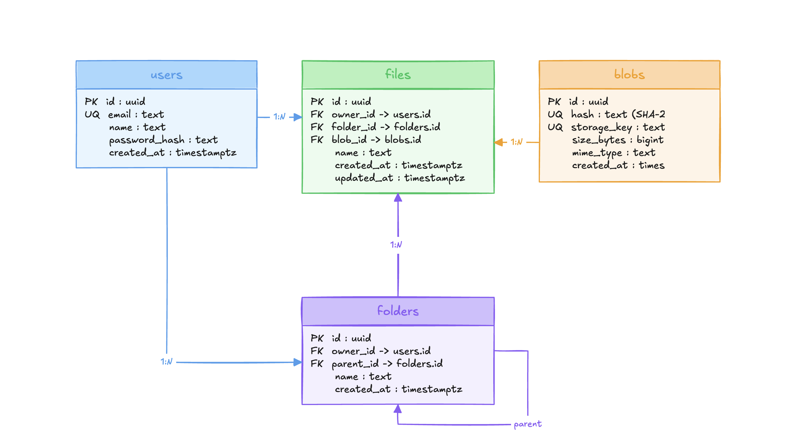
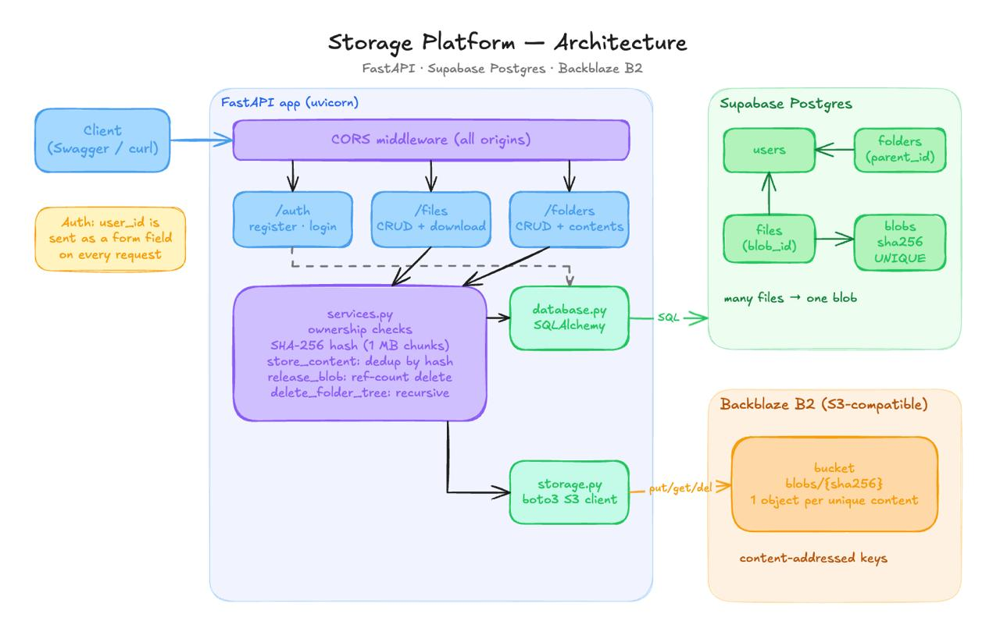
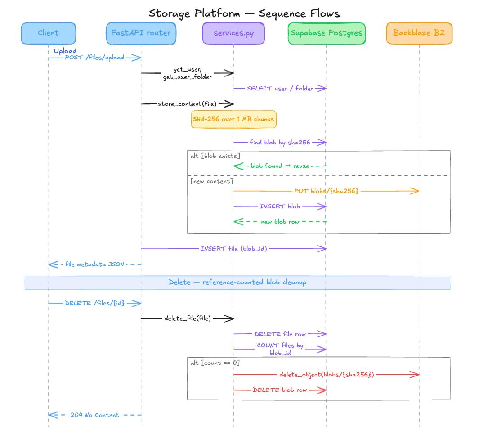
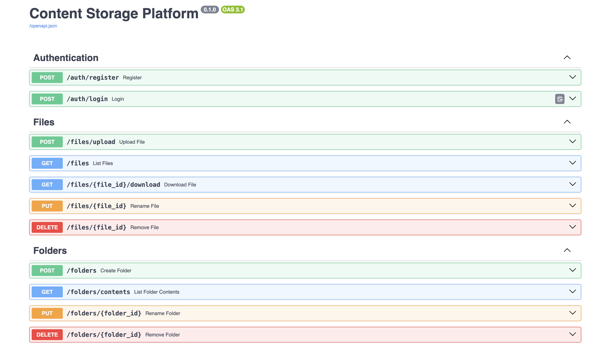
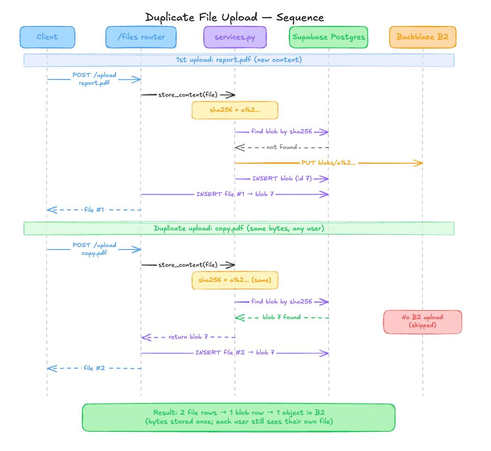

# Storage Platform
### A simple storage system where user can upload their files and folder 
- A simple working prototype(https://storage-platform-at2y.onrender.com/docs)

## Feature 
### Login
- A user can register and Login
### Folder
- create folder , and folder inside the folder
- open a folder to see its sub folder and see it files inside the folder
- rename a folder
### File
- upload a file into the root or a specific folder
- Download a file
- Rename a File
- Delete a file
### privacy
- every user can see and manage theri own folder
### Storage Optimization
- same file cant be uploded twice

### Deployment 
- I deployed the Backend on the render(https://storage-platform-at2y.onrender.com/docs)

### Tech stack
- backend - Fastapi
- db - Postgress on superbase
- orm - sql alchemy
- File storage - back blaze b2


Why back blaze s3 (https://www.backblaze.com/cloud-storage)
- It is cost free for 1st 10 gb and It work with s3 tools


# Diagram are Drawn through excalidraw
## Database schema



## Architecture Diagram


## Sequence Diagram


## How to run
Add the .env
```bash
cd backend
python -m venv venv
source venv/bin/activate
pip install -r requirements.txt
uvicorn app.main:app --reload
```
### Endpoints


### Novel Feature 
-- For storoge optimization I used Duplicate Detaiction using sha256 algorith


### what we can imporve
- Share
- Concurrency Control
- Move from one file to another file
- Move from one folder to another Folder

### Challenges Faced and overcomed

- Connectiy issue - I add a special chracter in my database url so it did not recoginize it
- Debugging takes more time than development
- While Deplying At First I add the superbase server url but the render reject it the build get failed and I added the session url

## Vs code
I am used Vs code  Auto complete

## Reference

- google
- stackoverflow
- Documentation
- mediunm
- reddit

